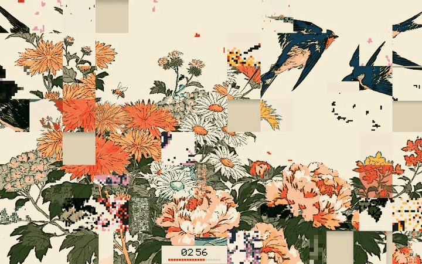

<h1 align="center">Shifting Garden</h1>

  A Mac screensaver of Japanese woodblock gardens cut into a sliding puzzle. 
  A few cells are empty. Blocks glide into the gaps, the picture drifts apart, then finds its way back.

  

## Try it

| | |
|---|---|
| **Mac screensaver** | [Download the latest release](https://github.com/kassem-kanjo/shifting-garden/releases/latest), unzip, double-click *Shifting Garden.saver* |
| **Build it yourself** | `mac/install.sh`, then System Settings → Screen Saver → *Shifting Garden* |
| **In a browser** | open `web/index.html` (press `n` for the next scene, `d` for the readout) |

## What you're looking at

**Four scenes, one at a time.** Flowers and swallows, koi and lotus, cranes and pine, peonies and butterflies. Each is a single print, flattened into a screenprint (flat inks, crisp black keylines) and cut into square blocks.

**It breathes.** Every slide is recorded while the picture comes apart. To bring it back, the slides play in reverse, so it always returns exactly whole, never "nearly". It rests for a moment, then a diagonal glitch wave reprints the blocks as the next scene.

**The countdown is exact.** The label at the bottom counts down to the moment the picture is whole again. The blocks move in waves on a fixed beat, so that moment is known in advance rather than guessed. The red squares fill as blocks get home.

**About a third of the blocks are corrupted,** and they re-roll as they travel:

| Glitch | Looks like |
|---|---|
| Dither | chunky 4-ink pixels (mint and black leaves, red and pink petals) |
| ASCII | the picture redrawn in code characters |
| Halftone | saturated print dots |
| Misregistration | the red plate slipped, like a misfed print |
| Two-ink | the block reprinted in just two inks |
| Wash | a flat ink pulled over the block |
| Specks | 8-bit red specks on bare paper |
| Wrong crop | a slightly wrong part of the picture |
| **Guest** | a block from one of the *other* scenes wandering in |

Blocks that are mostly bare paper only get the glitches that print something of their own, so nothing looks merely broken.

## How it's made

| Part | Where |
|---|---|
| Scenes | the author's Midjourney (V8.2), fake signatures painted out in the Editor; prompts in [notes/prompts.md](notes/prompts.md) |
| Screenprint treatment | [tools/pack_scenes.py](tools/pack_scenes.py): mean-shift + 14-ink k-means + keylines, packed as data URIs |
| Engine | [web/index.html](web/index.html): one canvas, no libraries, about 0.4 ms a frame |
| Mac wrapper | [mac/](mac/): a WKWebView screensaver built with `swiftc` only |

Why things are the way they are, including what was tried and dropped: [docs/DECISIONS.md](docs/DECISIONS.md). Changes: [CHANGELOG.md](CHANGELOG.md).
